**I build games, apps and the tooling behind them — from the first prototype to something people actually use.**

---

### About

I'm a developer working **across games, mobile and the web.** I write gameplay systems in **Luau** for Roblox and **Lua** for FiveM, ship cross-platform apps with **Flutter + Firebase**, and build production web apps with **Next.js, TypeScript and Prisma**.

I like owning a product end to end — the game loop, the backend, the admin tooling and the pipeline that generates the content. Most of my work lives in private repositories; the highlights are below.

---

### What I've built

**🧩 Vocabulary Puzzle Game** · *Flutter · Firebase · Python* 
A word-wheel / crossword puzzle game that teaches English. CEFR-levelled content (A1–C2), a word card for every answer with meaning, pronunciation and an example sentence, a personal word notebook and **FSRS spaced-repetition** review puzzles. Levels are produced by an offline **Python generation pipeline**.

**🗺️ Graph-Route** · *Next.js 14 · TypeScript · Prisma · Auth.js* 
A smart, sustainable **route optimization** platform — an authenticated multi-user web app with a relational data model, a shadcn/Tailwind UI with Framer Motion, and a dedicated marketing landing page.

**🏪 Web Studio Toolkit** · *Node.js · OpenStreetMap · Automation* 
An end-to-end system for selling websites to local businesses: **28 hand-designed single-file demo sites**, a CSV-driven site generator with sector-based palettes and typography, a **lead finder** that pulls businesses without a website from OpenStreetMap (Overpass) into Excel with ready-to-send outreach messages, and a local **admin panel with a built-in CRM**.

**🎮 Roblox** · *Luau · Rojo · Aftman* 
Contributor to **Tinyverse**, a team-built Roblox experience, plus my own Roblox projects — all with a professional file-based workflow (Rojo + Aftman), client/server architecture and source-controlled places instead of Studio-only code.

**⚔️ Strategy & Multiplayer** · *FiveM · RTS* 
Ongoing work on a **kingdom-wars strategy game**, a **native MMORTS prototype** and **FiveM** server resources — exploring game networking and large-scale game state.

---

### Beyond games

- 🤖 **Robotics** — team project on ROS 2 + Gazebo simulation: topic bridging and robot control → [btkamr_edu](https://github.com/ssefakeskin/btkamr_edu)
- ☕ **Java** — object-oriented programming workspace → [java_ws](https://github.com/ssefakeskin/java_ws)

---

### Stack

<table>
  <tr>
    <td width="50%" valign="top">
      <b>Languages</b>  
      
    </td>
    <td width="50%" valign="top">
      <b>Backend & Data</b>  
      
    </td>
  </tr>
  <tr>
    <td width="50%" valign="top">
      <b>Frontend & Mobile</b>  
      
    </td>
    <td width="50%" valign="top">
      <b>Game Dev</b>  
      <code>Roblox Studio</code> <code>Luau</code> <code>Rojo</code> <code>Aftman</code> <code>FiveM</code>
    </td>
  </tr>
  <tr>
    <td width="50%" valign="top">
      <b>Robotics</b>  
       
      <code>ROS 2</code> <code>Gazebo</code>
    </td>
    <td width="50%" valign="top">
      <b>Tooling</b>  
      
    </td>
  </tr>
</table>

---

### Now

- Polishing the vocabulary puzzle game toward a store release
- Growing my Roblox work with cleaner, modular gameplay systems
- Deepening multiplayer and networking skills through strategy game prototypes

---

  

<i>"Build it, ship it, then make it better."</i>

